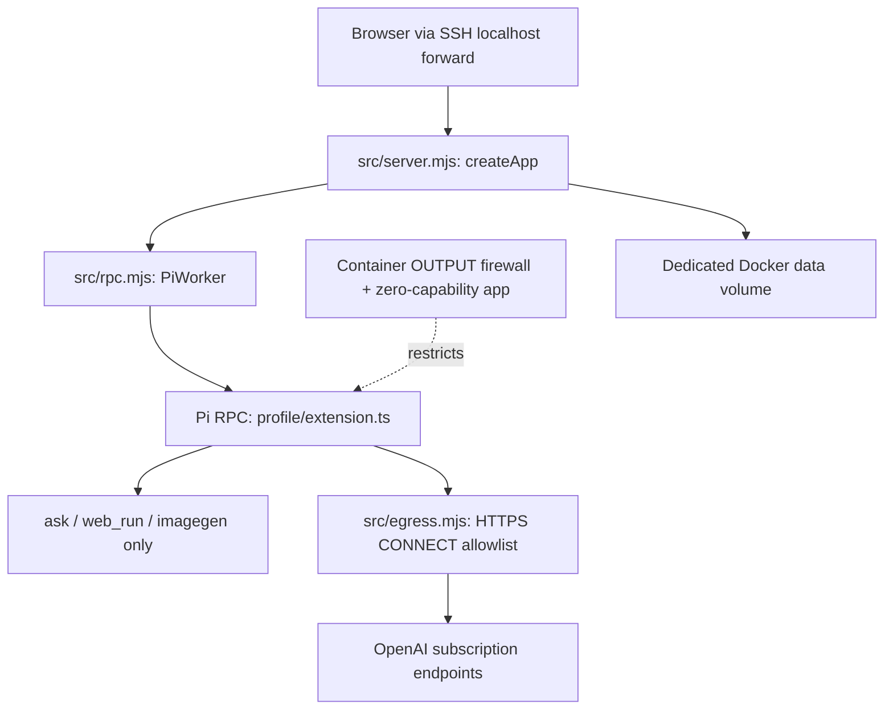

# Home Chat — local prototype

An everyday, mobile-friendly chat UI backed by a dedicated Pi profile and
Codex subscription authentication. This is **not publicly deployed**. There is
no Cloudflare configuration or Google authentication yet; the production
hostname is reserved conceptually as `home-chat.handmadeoasis.com`.

Source: https://github.com/ramtinJ95/home-chat. The public repository contains
code only, not credentials, conversations, generated images or local state.

## Development checkout

```sh
git clone https://github.com/ramtinJ95/home-chat.git
cd home-chat
```

Docker Desktop runs the isolated app. Host-side browser checks additionally
require Node.js 26.9.0 or newer, `npm ci`, and Google Chrome installed at the
standard macOS application path. `private: true` in package.json prevents
accidental npm publication; the GitHub source repository is public.

## Run on the Mac mini

```sh
cd ~/workspace/home-chat
export PATH="$HOME/.local/bin:/opt/homebrew/bin:$PATH"
docker compose build app
docker compose up -d --wait --wait-timeout 60
```

From your laptop, forward the loopback-only service:

```sh
ssh -N -L 127.0.0.1:8787:127.0.0.1:8787 home-macmini
```

Open **http://127.0.0.1:8787**. The production hostname and arbitrary Host
headers are deliberately rejected. Only localhost and 127.0.0.1 on port 8787
are accepted. Do not change the binding to `0.0.0.0` or add a tunnel yet.

### Local preview access

On first startup, two random 256-bit local access codes are generated in the
Docker data volume. Retrieve the desired code privately on the Mac mini:

```sh
docker compose exec -T --user 10001:10001 app node scripts/show-access.mjs owner
docker compose exec -T --user 10001:10001 app node scripts/show-access.mjs guest
```

Do not paste codes into an issue, commit or URL. These are **temporary local
preview credentials**, not the proposed permanent password/token scheme.
Login creates an 8-hour HttpOnly, SameSite=Strict cookie; sessions are revoked
on logout/restart. Five failed attempts per 15 minutes are allowed. The
cookie intentionally has no Secure attribute on this localhost HTTP preview.
Production must use HTTPS and Google/Cloudflare identity verification instead.

### Codex authentication

New installations start **without credentials** in the dedicated
`/data/profile`. No host profile is mounted. Until a login is provisioned,
sending a message explicitly returns 503; there is no API-key fallback or
mock answer in the running service. The fixed provider is `openai-codex`
and the model is `gpt-6-sol`, using subscription authentication.

For an isolated device-code login (requires enabling device-code login in
your OpenAI account security settings), run privately:

```sh
docker compose exec -T --user 10001:10001 app node scripts/login-codex.mjs
```

Alternatively, after a fresh Codex CLI login on the host, explicitly import
only its subscription OAuth credential:

```sh
node scripts/import-existing-codex.mjs --i-accept-shared-refresh-session
```

The importer reads `~/.codex/auth.json`, maps only the Codex OAuth fields and
pipes them into the isolated volume without printing tokens or modifying the
source file. It replaces the app's existing Codex credential. Copied refresh
sessions can conflict with the original CLI login; prefer isolated login
where available. Do not copy an entire personal profile. The current local
prototype was verified with an explicitly imported fresh CLI credential.

### Stop

```sh
docker compose stop
```

Data persists in Docker volume `home-chat_chat-data`. Do not use `down -v`
unless you intentionally want to delete all conversations and credentials.
Stopping this project does not stop Docker Desktop or unrelated containers.

## Architecture



`createApp` authenticates and checks conversation ownership before accepting
messages, image reads/uploads, event streams, or question answers. `PiWorker`
accepts only server-constructed RPC commands; browser text is prefixed so it
cannot be interpreted as Pi shell/slash commands. Each conversation has its
own Pi process/session and working directory. At most two workers run.

`profile/extension.ts` wraps extension registration: only `ask`, `web_run`
and `imagegen` can register. Active-tool changes are filtered; tool inputs are
checked both at Pi's `tool_call` boundary and in the tool execute wrapper.
Startup verifies the **actual registered and active** tool names. Image
understanding uses attached image content, not a filesystem reading tool.
No default tools, automatic extensions, skills, prompt templates, context
files, project trust or personal resources are loaded. The browser cannot
choose models, providers, credentials, config paths or RPC command names.

The default Codex-conversion adapter normally registers execution tools.
This wrapper drops those registrations instead of merely hiding them in the
UI. Shortcuts and extension commands are blocked except the adapter's internal
`pi-codex-context-tree-capture` initialization command, which captures its
runtime context without executing user code. It is not exposed to the browser.
Tools are limited to twelve calls and two image-generation requests per user
message.

## Network and process boundary

- App root filesystem read-only; only dedicated `/data`, bounded `/tmp` and
  `/run` are writable. No host home, SSH keys, normal Pi config or Docker
  socket mounts. The app runs UID 10001, with zero effective/inheritable/
  ambient/bounding capabilities and no-new-privileges after firewall setup.
- Startup briefly uses container-local NET_ADMIN/CHOWN/SETUID/SETGID/SETPCAP
  to install a fail-closed OUTPUT policy and drop privileges. Docker's tiny
  init stays root; it does not execute model requests. No host privileges or
  privileged container mode are used.
- App IPv4 egress permits established replies, its own loopback, and only
  `172.30.91.2:3128` (the proxy). Docker DNS at `127.0.0.11` is denied.
  IPv6 egress is denied except the container's own loopback. Network syscalls
  cannot reach host services, LAN, Tailscale, metadata or direct internet.
- A separate ingress bridge is needed for Docker to publish the loopback
  port; the OUTPUT firewall still denies direct egress on that interface.
- Egress proxy accepts CONNECT to exact `chatgpt.com`, `api.openai.com` and
  `auth.openai.com` on 443 only. It resolves the destination, rejects any
  non-public address, and connects to the validated IP (no second DNS lookup).
  Every subsequent connection is revalidated, including after redirects.
  Plain HTTP forwarding and arbitrary hosts are denied. TLS is not decrypted
  by the proxy. The normal web-search extension performs provider-hosted
  searches, not arbitrary local HTTP fetches.
- App: 2 CPUs, 2 GiB memory/no swap, 128 PIDs. Proxy: 0.25 CPU, 128 MiB,
  32 PIDs. Rotating Docker logs. Requests/images/responses/conversations and
  tool calls have explicit bounds; application data has a 512 MiB admission
  limit with generation headroom, **not a filesystem quota**.

The app and Pi dependencies remain trusted server-side code. A compromised
backend process could access the shared subscription token and stored chats;
application ownership checks are not separate OS identities. A container is
not a guarantee against kernel/runtime vulnerabilities. This local prototype
is not a production security certification.

## Tests

```sh
docker run --rm --network none --user 10001:10001 --cap-drop ALL \
  --security-opt no-new-privileges --entrypoint node home-chat-local:0.1.0 \
  --test test/policy.test.mjs test/server.test.mjs
docker compose exec -T --user 10001:10001 app node scripts/check-runtime.mjs
docker compose exec -T --user 10001:10001 app node scripts/check-network.mjs
```

Unit/application tests use an explicitly injected **fake Pi worker**; the
production entry point has no mock-mode switch. Runtime checks start the real
Pi and inspect its model/tool registry without inference. Network checks run
inside the deployed app namespace and probe denied connections plus allowed
provider TLS. These checks alone do not establish that inference works.

The separate live browser test uses subscription quota, including one image:

```sh
npm ci
node scripts/check-browser-live.mjs --confirm-subscription-usage
```

Verified on the Mac mini: real streamed subscription replies, interactive
`ask` round-trips, web search, uploaded-image understanding, and generated
image rendering/authenticated download. Chrome checks passed at desktop and
390px mobile viewports with no horizontal overflow or desktop JavaScript
errors. Screenshots stay in ignored `.local/`. This is browser emulation,
not a physical iPhone test.

Frontend renders all model text as textContent (plain text, not HTML/Markdown)
and uses a restrictive CSP. Images are authenticated, conversation-scoped
PNG assets. PNG/JPEG/WebP inputs up to 4 MiB and 16 million pixels are decoded,
stripped of metadata, scaled to 2048px and re-encoded. SVG is not accepted.
HEIC, voice, arbitrary file uploads and HTML artifacts are not in this phase.

Public deployment is not configured: Google-account allowlisting, MFA/passkey
policy, Cloudflare Access JWT verification, HTTPS-only cookies and identity
revocation remain unimplemented. Backup/retention decisions and an independent
security review are also outstanding. No automatic startup is enabled.
